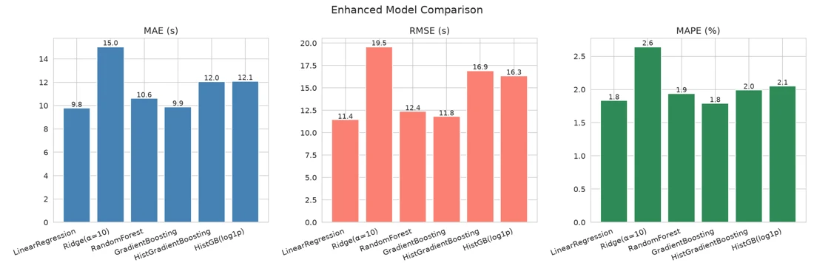

# Taxi Trajectory Mining

基于 Kaggle Porto Taxi Trajectory 数据集的课程设计代码仓库。

这是一个**代码仓库**。仓库中保留核心实验脚本，不包含原始数据、输出结果与报告产物。

## 主要任务

- 轨迹检索
- 异常轨迹检测
- 终点预测
- 行程时长预估
- 剩余步数预测对比
- OSM 路网特征增强
- 轨迹生成式探索

## 核心脚本

- `taxi_trajectory_retrieval.py`：轨迹检索
- `taxi_anomaly_detection.py`：异常检测
- `taxi_destination_prediction.py`：终点预测
- `taxi_duration_prediction.py`：行程时长预测
- `taxi_remaining_steps_compare.py`：剩余步数对比
- `task1_token_experiment.py`：Task 1 Token 实验
- `task3_token_osm_experiment.py`：终点预测 Token × OSM 实验
- `task3_60pct_osm.py`：60% 前缀 OSM 实验
- `task4_30point_experiment.py`：30 点统一前缀实验
- `task4_token_osm_experiment.py`：Token × OSM 交叉实验
- `task4_extras_gpu.py`：LSTM 与加权损失补充实验
- `task4_token_seq.py`：Task 4 序列实验
- `taxi_generative_duration.py`：生成式时长探索
- `taxi_generative_cluster_duration.py`：聚类版生成式探索
- `taxi_generative_grid_duration.py`：网格版生成式探索

## 依赖

```bash
pip install -r requirements.txt
```

建议使用 Python 3.10+。

## 数据准备

默认数据路径由脚本决定，通常需要你自行放入以下文件：

- `kaggle_dl/train.csv`
- `data/porto_highways_bbox.osm.json`

这些路径已在 `.gitignore` 中忽略，不建议提交到仓库。

## 快速开始

### 时长预测

```bash
python3 taxi_duration_prediction.py --mode real --data kaggle_dl/train.csv
```

### 终点预测

```bash
python3 taxi_destination_prediction.py --data kaggle_dl/train.csv
```

### 剩余步数对比

```bash
python3 taxi_remaining_steps_compare.py --data kaggle_dl/train.csv
```

## 仓库约定

建议只提交以下内容：

- `*.py` 核心脚本
- `README.md`
- `requirements.txt`
- `.gitignore`
- `LICENSE`（可选）

建议不要提交：

- `kaggle_dl/` 原始数据
- `data/porto_highways_bbox.osm.json`
- `output/` 生成物
- `report/` 报告草稿与导出文件
- `__pycache__/`、虚拟环境目录

## 说明

当前仓库保留课程实验脚本，便于复现实验与继续迭代。

## Automatic rendering / 自动渲染

[](https://github.com/Kevin0412/taxi_public/actions/workflows/render-gallery.yml)



Reproducible small synthetic-data run of the original duration prediction pipeline. These plots are smoke-test results, not measurements on Porto's real taxi dataset. Full sequence/OSM experiments are excluded.

[Download workflow artifacts](https://github.com/Kevin0412/taxi_public/actions).
